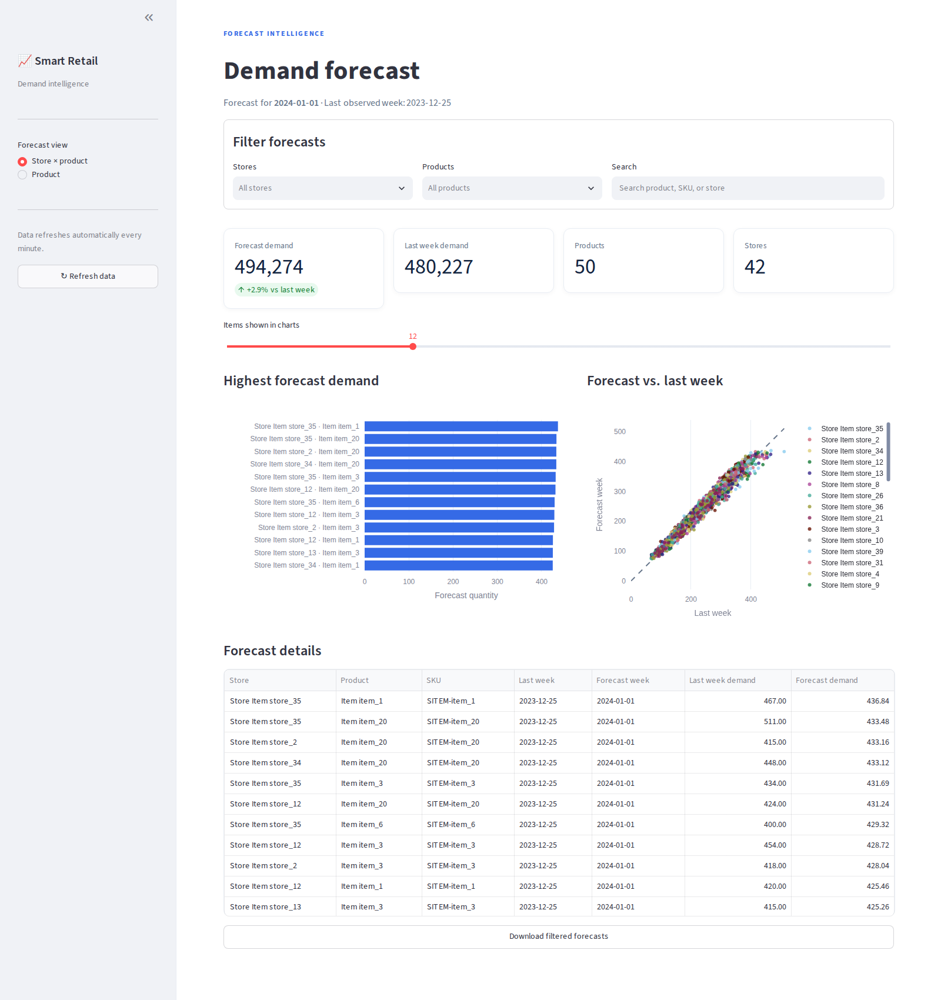
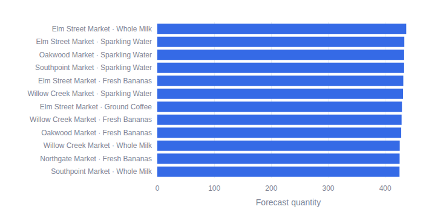
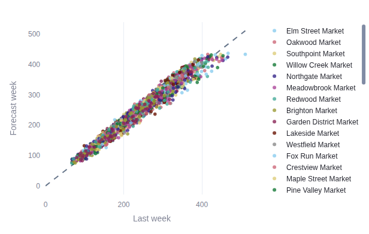

# Smart-Retail-Analytics-Demand-Forecasting

## Quick start

```bash
# 1. Install dependencies
pip install -r requirements.txt

# 2. Configure the database connection
cp .env.example .env        # then edit .env with your Neon/PostgreSQL URL

# 3. Create the tables
python -m src.database.create_schema

# 4. Load the data (see the sections below)
python -m src.data_ingestion.load_store_item_to_neon

# 5. Train + predict
python -m src.pipeline.run_full_pipeline
```

## Database schema

Install the project dependencies, configure `DATABASE_URL` in the repository's
`.env` file, then run this command from the repository root:

```bash
python -m src.database.create_schema
```

The command creates or updates the tables used by the loaders: categories,
suppliers, products, stores, customers, inventory, sales, sale items, returns,
supplier orders, and purchase items. It is safe to rerun; existing tables are
updated in place without dropping existing data.

Data is then loaded with the ingestion scripts:

```bash
python -m src.data_ingestion.insert_uci_sales_fast      # UCI Online Retail
python -m src.data_ingestion.load_store_item_to_neon     # Store Item
```

## Loading Store Item sales

Place the Store Item dataset at
`data/raw/store_item/retail_sales.csv`, then run:

```bash
python -m src.data_ingestion.load_store_item_to_neon
```

The loader maps each source store and item to `stores` and `products`, and
imports each store/item/day row into `sales` and `sale_items`. It processes
the source in chunks and loads each store in its own transaction:

- Each store is loaded atomically, so an interrupted import does not leave a
  partially committed store.
- Stores that are already complete are skipped; incomplete stores are safely
  reloaded when you rerun the command.
- For large imports, check that your database plan has enough available
  capacity for the dataset before loading.

The source does not include product costs, so the loader initializes each
product's catalog cost from its average source price. Replace those values
with actual costs before using the database for margin analysis.

## Running the pipeline

```bash
# Default: train the weekly Store Item model and predict next week
python -m src.pipeline.run_full_pipeline

# One model per product + store series (2,100 rows for 42 stores x 50 items)
python -m src.pipeline.run_full_pipeline --by-store

# Also run EDA and/or rebuild the daily feature file (both are slower)
python -m src.pipeline.run_full_pipeline --eda
python -m src.pipeline.run_full_pipeline --features
```

Individual stages:

```bash
python -m src.analytics.eda                              # EDA -> reports/eda/*.png
python -m src.features.feature_engineering               # data/features_demand.parquet
python -m src.models.train_strong SITEM-                 # product-level model
python -m src.models.train_strong SITEM- --by-store      # per-store model
python -m src.models.predict --top 10                    # product-level predictions
python -m src.models.predict_store --top 15              # per-store predictions
```

## Forecast dashboard

Explore weekly demand forecasts in an interactive Streamlit dashboard. The
screenshot below shows the store × product view.



The Store Item dataset contains anonymous item and store IDs rather than
verified catalog names. The readable product and store names shown here are
fictional demo labels mapped to those IDs; replace the mapping in
`src/display_names.py` with your catalog's actual names when available.

The dashboard includes:

- Forecast and last-week demand KPIs, with percentage change.
- Store, product, and text-search filters.
- Interactive charts for highest forecast demand and forecast-versus-history.
- A sortable forecast table and CSV export for filtered results.
- Automatic data refresh every minute, plus a manual refresh button.

### Plotly charts

**Highest forecast demand** ranks store-and-product combinations by predicted
weekly quantity. Use the dashboard slider and filters to explore different
items.



**Forecast vs. last week** compares predicted quantity with the previous week's
quantity for each store and product. Points near the dashed line indicate
similar demand; points above or below it indicate an increase or decrease.



### Run locally

Create the forecast CSV files before launching the dashboard. To generate
store × product forecasts, run:

```bash
python -m src.pipeline.run_full_pipeline --by-store
```

For product-level forecasts, the default is the top 10 products; request more
with, for example, `python -m src.models.predict --top 50`.

Start the API and dashboard in separate terminals from the repository root:

```bash
# Terminal 1: forecast API
uvicorn src.api.main:app --reload
```

```bash
# Terminal 2: dashboard
streamlit run src/dashboard/app.py
```

Open the dashboard at `http://localhost:8501`. The interactive API
documentation is at `http://localhost:8000/docs`. The API serves the generated
CSV files and does not need a live database connection. If the API is running
at another address, set `API_BASE_URL` before starting Streamlit.

### API endpoints

| Endpoint | Description |
| --- | --- |
| `GET /api/health` | API status and availability of each forecast file |
| `GET /api/summary?level=store` | Demand KPIs for store-level forecasts |
| `GET /api/summary?level=product` | Demand KPIs for product-level forecasts |
| `GET /api/forecasts?level=store&limit=100` | Store-level forecast rows |
| `GET /api/forecasts?level=product&limit=100` | Product-level forecast rows |
